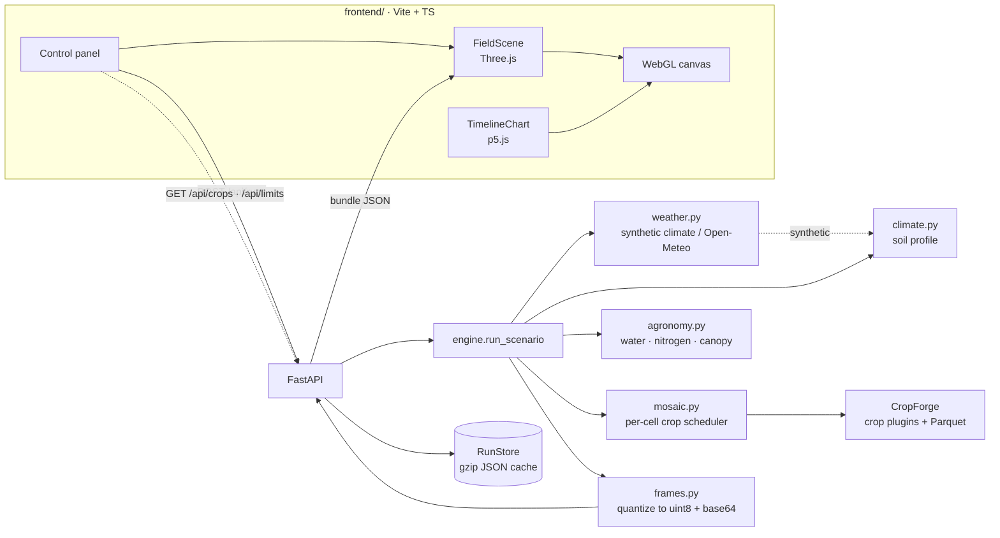

# Rancho · Farm Crop Simulation Console

> English version of the README. 中文版见 [README.md](README.md).

Day-by-day crop simulation on a rectangular grid field, with WebGL visualization. The backend uses [CropForge](https://pypi.org/project/cropforge/) for crops, radiation, and logging; the frontend renders the field and canopy with Three.js and the full-season trajectory with p5.js.

A 200-day simulation takes about 10 seconds; it is replayed day by day in the browser, where you can switch among 8 spatial channels to watch how water, nitrogen, stress, and disease distribute across the field.

## Quick start

```bash
uv sync
cd frontend && pnpm install && pnpm build && cd ..
uv run rancho serve           # http://127.0.0.1:8000/
```

Hot-reload frontend: one command brings up both the backend and vite (Ctrl+C stops both):

```bash
uv run rancho dev             # http://127.0.0.1:5173/, /api proxied to 8000
```

When you change ports, the frontend proxy follows: `uv run rancho dev --api-port 8010 --client-port 5180`.
Or start them in two terminals manually:

```bash
uv run rancho serve --no-open &
cd frontend && pnpm dev       # http://127.0.0.1:5173/, /api proxied to 8000
```

Run headless once and save as a bundle:

```bash
uv run rancho simulate --preset semi-arid --out runs/dry.json
```

Query observed weather at a coordinate (Open-Meteo, no API key required):

```bash
uv run rancho weather --lat 13.69 --lon -89.22 --start 2025-11-06 --days 130
```

Run the economic-layer prototype: three crops in one greenhouse compete for electricity and water, producing cost curves and validation findings.

```bash
uv run rancho econ            # 28 days, two tariff schemes, auto-opens an HTML report
```

## Interface

Opens by default to **greenhouse vegetables**: tomatoes under a bamboo trellis with a shade net in El Salvador, a 5 × 12 grid over 130 days. The default plot is deliberately small — 60 cells finish a run in under a second. **The simulation does not run on its own**: opening the page, switching scenarios, changing the layout, or dragging sliders only edits the configuration. Click **Run simulation** to start computing (the button shows a pending-run marker and the status bar reads "config changed"). To switch to cereals, leafy greens, or observed weather, just pick from the seven scenarios in the dropdown.

| Region     | Content                                                                                                    |
| ---------- | ---------------------------------------------------------------------------------------------------------- |
| Center     | Default 5 × 12 grid plot (1 m per cell); elevation from procedural terrain; canopy grows per-cell from biomass |
| Right      | Color channels, color scale, daily stats, vegetable layout, plot dimensions, plot parameters, and yield     |
| Bottom-left | p5.js full-season trajectory: LAI / water content / stress / rainfall; click or drag to locate a date      |
| Bottom     | Playback, timeline, speed, plant-height exaggeration factor                                                |

Interaction: `Space` play/pause, `←/→` single-day step, hover to read all channel values of a cell.

### Per-cell crop swapping

The color swatches in **Vegetable layout** are brushes: click to pick a crop, then **click or drag** across the plot to repaint the cells you pass over. Repainting is instant but **does not recompute** — only **Run simulation** re-runs with the new layout; repainting back to the original hits the cache and returns immediately.

| Control                      | Function                                                                                         |
| ---------------------------- | ------------------------------------------------------------------------------------------------ |
| Crop swatch                  | Pick the brush. The list comes from `/api/crops`; only crops with built-in phenology in Rancho are selectable (tomato / cucumber / lettuce) |
| Drag brush                   | When on, left-drag paints, right-drag pans, wheel zooms; off restores left-drag to orbit the view |
| Fill all / Stripe by column / Restore scenario | Fill with the current brush, split all crops evenly by column, return to the preset's original layout |
| Composition list             | How many cells and what percentage each crop occupies                                            |

Mixed cropping is more than swapping swatches — water, nitrogen, and yield all follow the crop; see [Per-cell mixed cropping](#per-cell-mixed-cropping). Cereal phenology is advanced field-wide by the CropForge plugin and cannot be assigned per cell, so the brush is greyed out when switching to the wheat / maize scenarios.

### Plot dimensions

The three **Plot dimensions** sliders change rows, columns, and days (4–72 × 4–96 × 10–240; bounds come from `/api/limits` and follow the validator). Dragging only updates the readout; releasing only changes the config — you still need **Run simulation**.

Days default to **following the crop**: the run lasts as long as the slowest crop takes to mature — tomato 130 d, cucumber 100 d, lettuce 60 d; a three-crop mix uses tomato's 130 d, so lettuce being harvested first does not cut the tomato season short. A hint below the slider shows who is in control; once you drag the days slider, you take over (the hint notes how many days the crop originally wanted), and switching scenarios hands control back to the crop. Two presets are **deliberately shortened**: arid zone 170 d and disease trial 190 d, both shorter than wheat's own 200 d, because they are meant to show the stress process rather than full-season yield.

Resizing does not lose the painted layout: each new cell takes the nearest cell at the same relative position — the server's `ScenarioConfig.with_grid` uses the same algorithm. More cells means slower runs; above 2400 cells the hint reads "a run takes tens of seconds to a minute". One run costs roughly one second per 25,000 cell·days, so the largest plot (72 × 96 × 240) is about a minute; only one simulation runs at a time and the UI does not queue a second while one is running.

## Model

CropForge provides the runtime, FAO-56 ET₀, radiation interception, crop plugins, and Parquet state logs. Rancho adds three pieces on top, because the original implementation grows the whole field identically:

| Stage                                        | Owner    | Notes                                                                                              |
| -------------------------------------------- | -------- | ------------------------------------------------------------------------------------------------- |
| Daily loop, phenology, radiation, logging    | CropForge | Used as-is, no fork                                                                                |
| Root-zone water balance                     | Rancho    | Replaces the layered tipping bucket: the latter refills every column to field capacity, erasing spatial differences |
| Nitrogen                                     | Rancho    | Mineralization + three topdressings − crop uptake − leaching, independent per cell                 |
| Canopy                                       | Rancho    | The plugin accumulates LAI only by thermal time, decoupled from stress; Rancho rescales it by the supply factor after the plugin |

The specifics (`rancho/agronomy.py`):

1. **Rainfall and runoff**: hillslope runoff is not discarded; it is routed to the downstream cell along the steepest descent, so depressions end up wetter.
2. **Zonal irrigation**: the structure covers only part of the plot (the mask is generated from quantiles of soil depth); outside the zone it is rainfed. Watering the driest cells first each day would flatten the whole field — exactly what we avoid.
3. **Stress coefficient**: FAO-56 single-layer root-zone bucket; `Ks` is set by the deficit level, `ETc = Kc·ET0·Ks`.
4. **Light partitioning**: the plugin intercepts light per plant via Beer–Lambert, which inflates interception 40× at 40 plants/m²; Rancho computes it once from canopy LAI and then distributes by plant count.
5. **Yield**: the plugin counts only the in-season increment during grain filling into grain, ignoring stem translocation and underestimating by about 4×; Rancho estimates from final dry matter × harvest index, while keeping the engine's original value in `yield.engine_t_per_ha`.

### Protected cultivation and vegetables

Switching the main crop from cereals to greenhouse vegetables is more than swapping a parameter table; four areas must change together:

| Stage                | Treatment                                                                                                                                                          |
| -------------------- | ----------------------------------------------------------------------------------------------------------------------------------------------------------------- |
| Climate              | New `tropical`: 23–27 ℃ year-round, dry season Nov–Apr, rainy season May–Oct; rainfall probability itself is cosine-modulated rather than constant                  |
| In-greenhouse microclimate | With `protected=True`, rainfall is zeroed, radiation is multiplied by `cover_transmission` (film 0.85 × shade net 0.65 ≈ 0.55), wind speed drops to 0.2 m/s, humidity rises; ET₀ falls from 3.5–4 mm/d open-field to 2.0–2.7 mm/d |
| Crop                 | `rancho/vegetables.py` provides tomato / cucumber / lettuce plugins: thermal-time phenology to harvest, trellis-limited height, canopy still updating through the fruiting period |
| Water & fertilizer   | Root-zone depth, Kc, and allowable depletion fraction are taken per crop (`agronomy.CROP_WATER`): tomato 450 mm / 1.15 / 0.40, instead of cereals' 300 mm / 1.05 / 0.50 |
| Yield                | The harvest index gives fruit dry matter, then converted to marketable fresh yield by dry-matter fraction and marketable fraction                                |

The spatial structure is not flattened by this: about 10 % of border beds inside the greenhouse still lack irrigation, the stress index spans 0–1 across the plot, and LAI ranges from 1.1 to 3.3. Site interpretation, cropping sequence, and water/fertilizer rationale are in [`docs/salvador-greenhouse.md`](docs/salvador-greenhouse.md).

### Per-cell mixed cropping

A greenhouse usually grows more than one vegetable. `ScenarioConfig.crop_map` assigns a crop to **every cell** (row-major, length must equal `rows × cols`), and `rancho/mosaic.py`'s `CropMosaic` hands each plant to the plugin of the crop in its cell.

| Stage   | Treatment                                                                                                                       |
| ------- | ------------------------------------------------------------------------------------------------------------------------------ |
| Growth  | One scheduler plugin holds several sub-plugins and dispatches per plant by looking up its cell; a uniform layout takes the "same sub-plugin" path, identical bit-for-bit to a single-crop run (pinned by a test) |
| Water   | Root-zone depth, `Kc`, allowable depletion `p`, and extinction coefficient all become `(rows, cols)` arrays; each bed transpires from its own bucket |
| Nitrogen | Topdressing follows **each crop's** `splits` per bed; a tomato bed with six dressings and a lettuce bed with three do not interfere, and the seasonal total is unchanged |
| Yield   | Each crop is first converted to fresh weight by its own harvest index, dry-matter fraction, and marketable fraction, then area-weighted into t/ha for the whole plot; `yield.crops` keeps each crop's ledger |
| Days    | Omit `days` and it follows the **slowest** crop in the field: tomato 130 > cucumber 100 > lettuce 60; a mix uses 130, so an early-harvested crop does not shorten the whole season |

Two boundaries must be clear:

- **Only crops with built-in phenology in Rancho can be assigned per cell** (currently tomato / cucumber / lettuce). Wheat and maize phenology is advanced field-wide in one `step` by the CropForge plugin with no per-plant entry point; writing them into `crop_map` fails validation outright instead of running silently wrong — `MOSAIC_KEYS` is derived from the template's `has_phenology`, so adding a TOML with a phenology section makes a crop automatically mixable.
- **The `crop` of a mixed scenario must also be a mixable crop**: it is the crop the plot reports outward and the basis on which the engine picks a plugin; you cannot report wheat while laying out tomato.

In the UI this is the **Vegetable layout** panel: pick a swatch → paint on the plot → click **Run simulation**. The CLI can resize too, and the layout scales with it (`with_grid`); `simulate` prints each crop's ledger.

### Crop templates

Parameters for the three vegetables and two cereals are no longer hardcoded in Python: `rancho/crops/*.toml` holds one file per crop, and the growth phenology, root-zone water/nitrogen, product conversion rates, and economic-layer prices are all read from it. Adding a crop means adding a file — `CROP_KEYS` and the crop plugin are both derived from the template, so you no longer edit `scenario` or `vegetables`. Edit a value, save, restart the process — no build step needed.

```bash
uv run rancho crops            # print the five active templates and their paths
```

Fields, units, load-time validation rules, and "add a crop" are in [`docs/crops.md`](docs/crops.md). Cereal phenology is still handled by CropForge's built-in plugins; the template only carries Rancho's side of the coefficients and product conversions.

### Weather: synthetic climate and observed data

`weather.source` decides where daily weather comes from; both paths write the same CSV and go through the same FAO-56 pipeline:

| Value               | Source                | Notes                                                                                              |
| ------------------- | --------------------- | ------------------------------------------------------------------------------------------------- |
| `synthetic` (default) | `climate.py`        | Seasonal curves per climate band + fixed seed; fully offline and bit-for-bit reproducible         |
| `open-meteo`        | [Open-Meteo](https://open-meteo.com/) | ERA5 reanalysis by lat/lon (0.25° ≈ 25 km); dates located by `weather.year` + `sowing_doy` |

Field mapping (`rancho/weather.py`):

| CSV column          | Open-Meteo daily variable       | Unit handling                                                  |
| ------------------- | -------------------------------- | ------------------------------------------------------------- |
| `tmax_c` / `tmin_c` | `temperature_2m_max` / `_min`    | ℃                                                             |
| `radiation_mj`      | `shortwave_radiation_sum`        | already MJ/m²/day                                             |
| `rainfall_mm`       | `precipitation_sum`              | mm                                                            |
| `humidity_pct`      | `relative_humidity_2m_mean`      | %                                                             |
| `wind_ms`           | `wind_speed_10m_mean`            | km/h ÷ 3.6 (daily mean, not daily max — ET₀ needs mean wind speed) |

```python
weather=WeatherConfig(source="open-meteo", year=2025)   # fallback / offline / timeout_s are optional
```

| Design choice     | Approach                                                                                                                                                         |
| ----------------- | ---------------------------------------------------------------------------------------------------------------------------------------------------------------- |
| Unified pipeline  | Observed values are also written to CSV first, then computed by CropForge. The `protected` in-greenhouse conversion (light transmission, rain shielding, 0.2 m/s, humidity +5 %) is applied before writing, so the two paths differ only in the numeric series itself |
| Reproducible      | Responses are cached by `(coordinate, start/end date)` under `<work-dir>/weather/`; finalized reanalysis is reused permanently, while data from the last 5 days is refetched after 6 hours; `offline=True` reads the cache only |
| Fail loud         | If fetching fails and `fallback=True`, it falls back to synthetic climate and writes the reason into `meta.weather.notes`; with `fallback=False` it errors outright |
| No source mixing  | When the date is later than the reanalysis latency, it switches to the forecast API and marks the source in `notes`                                              |

Daily series, caching policy, quality handling, and known limitations are in [`docs/weather.md`](docs/weather.md). Data license CC-BY 4.0 (Open-Meteo / ECMWF ERA5).

### Economic layer · Mesa auction

The physical layer answers "how much can grow"; the economic layer answers "how much it costs and who pays". `rancho.econ` hangs an hourly market on top of the physical layer: one greenhouse Agent holds four capacities — electricity, cooling/heating, water, fertilizer — and three crop Agents each bid by **marginal value**; the greenhouse allocates sequentially in descending value order, and the part that cannot clear is the overallocation.

| Design        | Approach                                                                   | Why                                                                                                                      |
| ------------- | -------------------------------------------------------------------------- | ----------------------------------------------------------------------------------------------------------------------- |
| Step          | Hourly (672 steps / 28 days)                                               | Daily-average tariffs would flatten off-peak arbitrage; at El Salvador retail tariffs supplemental-lighting procurement is 0 kWh, and the decision only enters below 0.06 USD/kWh |
| Order         | Cooling/heating before supplemental lighting                               | Temperature control prevents irreversible quality damage; lighting only adds yield                                       |
| Bidding       | Each bid is split into 3 steps, priced by the temperature band actually bought | The response is concave, so the clearing price lands inside the bid band, not at its edge                            |
| Reserve price | Cooling/heating `tariff/COP`, lighting `tariff`, fertilizer at market price; none for irrigation | Irrigation is a hard operating constraint — you would not let a bed wilt to save 4 yuan/m³                           |
| Three arms    | solo (capacity ×10⁴) / pooled (actual) / null (×10³)                       | null must equal solo bit-for-bit, otherwise the allocator itself is biased                                              |

Yield can come from three sources:

| `--growth`          | Yield source                                                                       | Marginal value                              | Cost          |
| ------------------- | ---------------------------------------------------------------------------------- | ------------------------------------------- | -------------- |
| `cropforge` (default) | `rancho.vegetables` plugin + Beer–Lambert interception                          | Differentiate w.r.t. DLI                     | within seconds |
| `farm`              | Actually run the CropForge farm (6×6 field, radiation hook, daily engine) and iterate with the market | Daily differentiation after re-running the whole season at ±10 % light | ~0.7 s         |
| `analytic`          | Saturating light-response proxy for the first stage                               | Analytic derivative                         | within seconds |

A 28-day comparison at a tropical site under two tariff schemes (`uv run rancho econ`):

| Yield source | Scenario     | Tomato | Cucumber | Lettuce | Spread |
| ------------ | ------------ | ------ | ------- | ------- | ------ |
| `farm`       | `sv_horaria` | −0.3 % | +1.4 %  | +2.2 %  | 2.5 %  |
| `farm`       | `sv_plana`   | −0.5 % | +0.5 %  | +2.2 %  | 2.6 %  |
| `cropforge`  | `sv_horaria` | −0.3 % | +1.4 %  | +2.2 %  | 2.5 %  |
| `cropforge`  | `sv_plana`   | −0.5 % | +0.5 %  | +2.2 %  | 2.6 %  |
| `analytic`   | `sv_horaria` | −1.4 % | +6.1 %  | −0.5 %  | 7.5 %  |
| `analytic`   | `sv_plana`   | −1.5 % | +6.8 %  | −0.2 %  | 8.3 %  |

(Values are unit-cost changes of the most-constrained crop; all six pass the criterion, `null_gap = 0`.)

`farm` and `cropforge` come out almost identical, by design: the former truly runs the engine while the latter evaluates the same set of equations through the interface; their agreement shows the first two stages' yield was not tuned. `farm` converges in two iterations to a 0.008 % residual, at the cost of 36 farm-season runs (about 0.01 s each).

**Cucumber is the marginal producer**: after sharing, it is systematically squeezed out of cooling/heating — 59 % overallocated, accounting for 78 % of the greenhouse's total over-allocation; its declared cooling/heating drops 308 → 125 kWh_th, yield −18 %, gross margin −18.5 %. But its unit cost moves only +1.4 %: cost and yield shrink together, so the real loss lands on gross margin, not unit cost.

**Lettuce runs a negative gross margin** (−124 yuan): selling at 7 yuan/kg against a unit cost of 10.67 yuan/kg, of which 140.8 yuan is cooling. Its critical temperature is only 29 ℃, so in the tropical rainy season it is forced to bid; it can bid up to 6× tomato's rate (1.141 vs 0.191 yuan/kWh_th) and still loses money. This is the other side of "rank by marginal value" — a correct ordering does not mean the deal is viable.

On the cost structure, electricity is 88 % (temperature control + supplemental lighting + standby overhead), while water and fertilizer are only 12 %. Under `cropforge`, tomato buys 699 kWh of supplemental lighting (zero under `analytic`) because every extra mol is worth 6–12 g, i.e. 14 yuan/kg.

Model boundaries, criterion thresholds, scarcity-moment statistics, and problems exposed by switching yield sources (potential yield follows the canopy, damage priced per day triggers a death spiral, the farm season must start from transplanted seedlings) are all in [`docs/economics.md`](docs/economics.md).

## Presets

| ID                    | Scenario                                | Highlights                                                                                                                   |
| --------------------- | --------------------------------------- | --------------------------------------------------------------------------------------------------------------------------- |
| `rabi-wheat`          | Winter wheat · conventional irrigation  | Gentle slope, patchy soil, zonal irrigation; yield 2.7 t/ha                                                                 |
| `kharif-maize`        | Summer maize · rainfed                  | Flat clay loam, no irrigation, watch the rainfall rhythm                                                                     |
| `semi-arid`           | Arid zone · water stress                | Sandy loam + undulating terrain; stress index spans 0.17–0.99                                                                |
| `disease-front`       | Disease spread · resistance trial       | Spatial SIR spread, advancing outward from two infection foci                                                                |
| `salvador-greenhouse` | El Salvador · greenhouse tomato         | **Default scenario**. Bamboo trellis + shade net + insect net, andosol gentle-slope drip irrigation, 5 × 12 grid · 130 days · 62.7 t/ha |
| `salvador-mosaic`     | El Salvador · greenhouse mixed cropping | Same greenhouse split by bed into tomato / cucumber / lettuce, 130 days (tomato decides), watch cross-bed competition for water and nitrogen |
| `salvador-leafy`      | El Salvador · greenhouse leafy greens   | Same structure replanted with lettuce, short 60-day cycle, 43.8 t/ha                                                        |
| `salvador-observed`   | El Salvador · greenhouse tomato (observed weather) | Same agronomy, weather swapped for 2025/26 Open-Meteo observations, 130 days 66.0 t/ha                          |

## Architecture



One frame bundle stores just one value per cell: 8 channels × 200 days × 884 cells quantized to base64 is about 650 kB, and decoding on the browser is pure byte math, so switching days triggers no network request.

## API

| Method | Path             | Notes                                                                                                   |
| ------ | ---------------- | ------------------------------------------------------------------------------------------------------ |
| GET    | `/api/health`    | Version and engine self-check                                                                          |
| GET    | `/api/presets`   | Built-in scenarios and their full config; `default: true` marks the default                           |
| GET    | `/api/crops`     | Selectable crops: display name, whether per-cell mixing is supported, full-season thermal sum, **days to maturity**, root-zone depth |
| GET    | `/api/limits`    | `rows` / `cols` / `days` bounds, taken directly from the validator; the UI sets its sliders from these |
| GET    | `/api/weather`   | `?lat=&lon=&start=&days=` fetches observed daily weather; `protected=true` optional                    |
| POST   | `/api/runs`      | `{"preset": "salvador-greenhouse"}` or `{"config": {...}}`; returns immediately on cache hit; returns 503 when the engine is busy |
| GET    | `/api/runs`      | Summary list of cached runs                                                                            |
| DELETE | `/api/runs/{id}` | Delete a cache entry                                                                                   |

Once `config` is given it **fully replaces** `preset` — not a patch. The UI therefore always fetches the full preset config first, then edits `rows` / `cols` / `days` / `crop_map` before submitting; sending only three fields yields a scenario padded with defaults (crop reverts to wheat), which is intentional: merge semantics cannot distinguish "not given" from "given the default".

CropForge's Parquet logs are resolved against the **process working directory**, so only one simulation can run per process: a second request does not queue for a minute but immediately gets 503 "a simulation is already running". The CLI `rancho simulate` takes the opposite path — it is willing to queue, because no one is watching the progress bar.

Interactive docs: `/api/docs`.

## Validation

```bash
ruff format . && ruff check . && ty check
uv run pytest
cd frontend && pnpm lint && pnpm fmt:check && pnpm typecheck && pnpm build
```

`pytest` is the only dev dependency (`uv add --group dev pytest`); 165 cases take about six seconds and make no network calls (every case in `test_econ_farm.py` truly runs a farm-season run, and `test_mosaic.py` has a small 4×6 mixed-cropping end-to-end run). Coverage is in [`docs/economics.md`](docs/economics.md#测试) and [`docs/crops.md`](docs/crops.md#加载时校验).

`ruff` / `ty` / `oxlint` / `oxfmt` are not project dependencies: they come from the system environment (`scoop install ruff ty oxlint oxfmt`), so neither `uv sync` nor `pnpm install` installs them, and their versions follow the system, not the lockfile. Python 3.14 or above is required.

## Directory

```text
rancho/
  scenario.py   scenario config, per-cell crop layout, and the eight presets
  climate.py    synthetic climate and soil profile (same seed, bit-for-bit reproducible)
  weather.py    weather by lat/lon (Open-Meteo), caching, CSV serialization
  agronomy.py   per-cell water, nitrogen, canopy (coefficients per cell, not per field)
  vegetables.py greenhouse vegetable plugins (tomato / cucumber / lettuce)
  mosaic.py     per-cell crop scheduling: each plant to the plugin of its cell's crop
  crops/        crop templates (TOML) + phenology vocabulary + load-time validation
  engine.py     assemble the Farm and run one simulation
  frames.py     Parquet → render bundle
  api.py        FastAPI
  store.py      in-memory + gzip two-level cache
  cli.py        dev / serve / simulate / weather / presets / crops / econ
  econ/         economic layer: parameters, exogenous series, yield functions, farm driver, Mesa auction, three-arm comparison, report
frontend/src/
  scene.ts      Three.js: terrain, canopy instances, rain, picking and painting
  chart.ts      p5.js: full-season small multiples
  main.ts       state and interaction: scenario, layout brush, grid sliders
docs/
  salvador-greenhouse.md  site interpretation, cropping sequence, and water/fertilizer rationale for the protected-culture retrofit
  weather.md              observed-weather sources, field mapping, caching, and limitations
  economics.md            economic-layer auction mechanism, three-arm criteria, and limitations
  crops.md                crop-template fields, validation, and derived relationships
tests/
  support.py              build an arm snapshot without running the model
  test_crops.py           templates reproduce original values (exact equality) and every validation rule
  test_mosaic.py          per-cell mixed cropping: layout validation, dispatcher, per-cell water/nitrogen, end-to-end small run
  test_econ_market.py     sequential allocation and overallocation accounting
  test_econ_verdict.py    three-arm criterion threshold boundaries
  test_econ_forcing.py    tariff shape, daylight window, water-price range
  test_econ_growth.py     two yield functions (analytic proxy / CropForge plugin)
  test_econ_farm.py       real farm season, response-table anchors, two backends agree
  test_econ_run.py        invariants from a short-window real run
```
