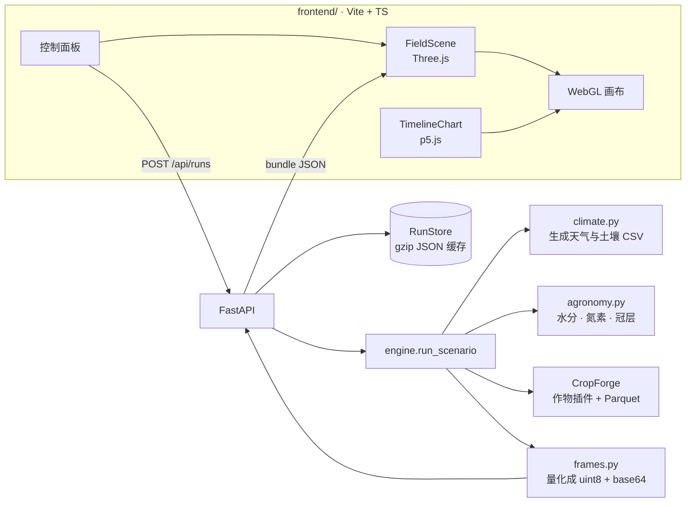

# Rancho · 农田作物仿真台

矩形网格农田的逐日作物仿真与 WebGL 可视化。后端用 [CropForge](https://pypi.org/project/cropforge/)
做作物、辐射与日志，前端用 Three.js 渲染地块与冠层、p5.js 画全季轨迹。

一次 200 天的仿真约 10 秒，浏览器里逐日回放，可切换 8 个空间通道观察水分、
氮素、胁迫与病害如何在田块内分布。

## 快速开始

```bash
uv sync
cd frontend && pnpm install && pnpm build && cd ..
uv run rancho serve           # http://127.0.0.1:8000/
```

前端热更新：

```bash
uv run rancho serve --no-open &
cd frontend && pnpm dev       # http://127.0.0.1:5173/，/api 已代理到 8000
```

无界面跑一次并存成 bundle：

```bash
uv run rancho simulate --preset semi-arid --out runs/dry.json
```

## 界面

| 区域 | 内容 |
| --- | --- |
| 中央 | 26 × 34 格的地块（每格 1 m），高程来自程序化地形，冠层按每格生物量生长 |
| 右侧 | 着色通道、色标、当日统计、地块参数与产量 |
| 左下 | p5.js 全季轨迹：LAI / 含水率 / 胁迫 / 降水，可点击或拖动定位日期 |
| 底部 | 播放、时间轴、速度、株高夸张系数 |

交互：`空格` 播放暂停，`←/→` 单日步进，鼠标悬停读出该格全部通道值。

## 模型

CropForge 提供运行时、FAO-56 ET₀、辐射截获、作物插件与 Parquet 状态日志。
Rancho 在它之上补了三处，因为原实现会让整块地长出一样的东西：

| 环节 | 归谁 | 说明 |
| --- | --- | --- |
| 逐日循环、物候、辐射、日志 | CropForge | 原样使用，不 fork |
| 根区水量平衡 | Rancho | 替换分层 tipping bucket：后者会把每列回补到田间持水量，空间差异归零 |
| 氮素 | Rancho | 矿化 + 三次追肥 − 作物带走 − 淋洗，逐格独立 |
| 冠层 | Rancho | 插件只按热时间累积 LAI，与胁迫脱钩；Rancho 在插件之后按供给系数缩放 |

具体做法（`src/rancho/agronomy.py`）：

1. **降水与径流**：坡面径流不丢弃，按最陡下降方向送给下游格，洼地因此更湿。
2. **分区灌溉**：设施只覆盖地块的一部分（掩膜由土壤深度的分位数生成），
   区外靠雨养。若每天优先浇最干的格，等于把整块地拉平——这正是要避免的。
3. **胁迫系数**：FAO-56 单层根区桶，`Ks` 由亏缺程度给出，`ETc = Kc·ET0·Ks`。
4. **配光**：插件按单株 Beer-Lambert 截获，40 株/m² 就会把光截获放大 40 倍；
   Rancho 改为按冠层 LAI 算一次，再按株数分摊。
5. **产量**：插件只把灌浆期当季增量计入籽粒，忽略茎秆转运，低估约四倍；
   Rancho 用最终干物质 × 收获指数估算，引擎原值仍保留在 `yield.engine_t_per_ha`。

## 预设

| ID | 场景 | 看点 |
| --- | --- | --- |
| `rabi-wheat` | 冬小麦 · 常规灌溉 | 缓坡、斑块状土壤、分区灌溉，产量 2.7 t/ha |
| `kharif-maize` | 夏玉米 · 雨养 | 平地黏壤，无灌溉，看降水节律 |
| `semi-arid` | 旱区 · 水分胁迫 | 沙壤 + 起伏地形，胁迫指数跨 0.17–0.99 |
| `disease-front` | 病害扩散 · 抗性试验 | SIR 空间扩散，从两个发病中心向外推进 |

## 架构



一帧 bundle 只存每格一值：8 个通道 × 200 天 × 884 格量化成 base64 后约 650 kB，
浏览器端解码是纯字节运算，切日不触发网络请求。

## API

| 方法 | 路径 | 说明 |
| --- | --- | --- |
| GET | `/api/health` | 版本与引擎自检 |
| GET | `/api/presets` | 内置场景及其完整配置 |
| POST | `/api/runs` | `{"preset": "rabi-wheat"}` 或 `{"config": {...}}`，命中缓存直接返回 |
| GET | `/api/runs` | 已缓存运行的摘要列表 |
| DELETE | `/api/runs/{id}` | 删除缓存 |

交互式文档：`/api/docs`。

## 校验

```bash
uv run ruff format src && uv run ruff check src && uv run ty check
cd frontend && pnpm lint && pnpm fmt:check && pnpm typecheck && pnpm build
```

## 目录

```
src/rancho/
  scenario.py   场景配置与四个预设
  climate.py    天气 / 土壤生成（同一 seed 逐位可复现）
  agronomy.py   逐格水分、氮素、冠层
  engine.py     组装 Farm，跑一次仿真
  frames.py     Parquet → 渲染用 bundle
  api.py        FastAPI
  store.py      内存 + gzip 两级缓存
  cli.py        serve / simulate / presets
frontend/src/
  scene.ts      Three.js：地形、冠层实例、雨、拾取
  chart.ts      p5.js：全季小多图
  main.ts       状态与交互
```
