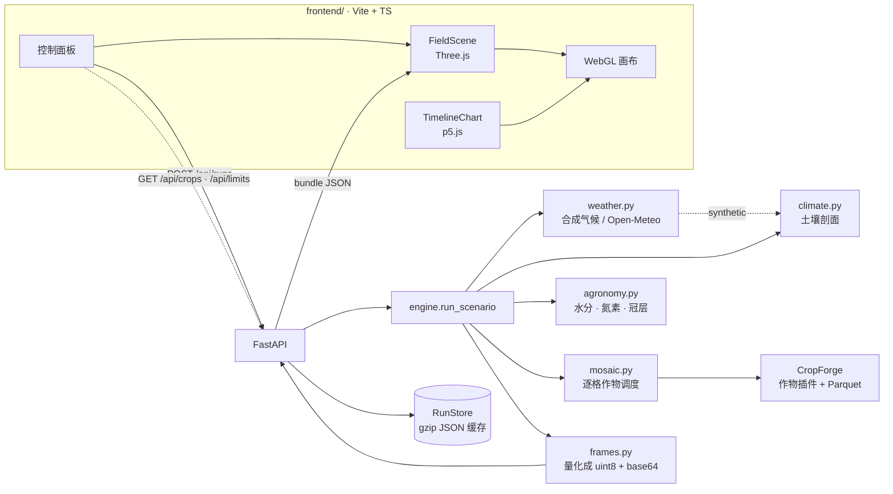

# Rancho · 农田作物仿真台

矩形网格农田的逐日作物仿真与 WebGL 可视化。后端用 [CropForge](https://pypi.org/project/cropforge/)
做作物、辐射与日志，前端用 Three.js 渲染地块与冠层、p5.js 画全季轨迹。

一次 200 天的仿真约 10 秒，浏览器里逐日回放，可切换 8 个空间通道观察水分、
氮素、胁迫与病害如何在田块内分布。

## 快速开始

```bash
uv sync
cd frontend && pnpm install && pnpm build && cd ..
uv run rancho serve           # http://127.0.0.1:8000/
```

前端热更新，一条命令把后端和 vite 一起拉起来（Ctrl+C 一起停）：

```bash
uv run rancho dev             # http://127.0.0.1:5173/，/api 代理到 8000
```

换端口时前端代理会跟着走：`uv run rancho dev --api-port 8010 --client-port 5180`。
也可以分两个终端手动起：

```bash
uv run rancho serve --no-open &
cd frontend && pnpm dev       # http://127.0.0.1:5173/，/api 已代理到 8000
```

无界面跑一次并存成 bundle：

```bash
uv run rancho simulate --preset semi-arid --out runs/dry.json
```

查某个坐标的实测气象（Open-Meteo，无需密钥）：

```bash
uv run rancho weather --lat 13.69 --lon -89.22 --start 2025-11-06 --days 130
```

跑经济层原型：同一座棚里三种作物争电、争水，出成本曲线与验证结论。

```bash
uv run rancho econ            # 28 天、两种电价、自动打开 HTML 报告
```

## 界面

默认打开**大棚蔬菜**：萨尔瓦多竹架棚、遮阳网下的番茄，130 天。想换谷物、叶菜或实测气象，
下拉框里七个场景随手切。

| 区域 | 内容                                                                   |
| ---- | ---------------------------------------------------------------------- |
| 中央 | 18 × 40 格的地块（每格 1 m），高程来自程序化地形，冠层按每格生物量生长 |
| 右侧 | 着色通道、色标、当日统计、蔬菜布局、地块尺寸、地块参数与产量           |
| 左下 | p5.js 全季轨迹：LAI / 含水率 / 胁迫 / 降水，可点击或拖动定位日期       |
| 底部 | 播放、时间轴、速度、株高夸张系数                                       |

交互：`空格` 播放暂停，`←/→` 单日步进，鼠标悬停读出该格全部通道值。

### 逐格换作物

「蔬菜布局」里的色片就是画笔：点一下选作物，在地块上**点击或拖拽**就把经过的格子换成它。
改动后约 0.5 秒自动重跑；画回原来的样子会命中缓存，立刻回来。

| 控件                                | 作用                                                                          |
| ----------------------------------- | ----------------------------------------------------------------------------- |
| 作物色片                            | 选画笔。列表来自 `/api/crops`，只有 Rancho 自带物候的作物可选（番茄/黄瓜/生菜）|
| 拖拽画笔                            | 打开时左键拖动作画，右键平移、滚轮缩放；关掉后左键恢复旋转视角                |
| 整块填充 / 按列分带 / 还原场景      | 铺满当前画笔、按列均分所有作物、回到预设的原始布局                            |
| 构成列表                            | 每种作物占多少格、百分之多少                                                  |

混作不是换色片那么简单——水、氮与产量都按作物走，见[逐格混作](#逐格混作)。谷物的物候由
CropForge 插件整块推进、无法逐格指派，所以切到小麦 / 玉米场景时画笔置灰。

### 地块尺寸

「地块尺寸」三个滑块分别改行数、列数、天数（4–72 × 4–96 × 10–240，上下界由 `/api/limits`
给出，跟着校验器走）。**松开滑块才发起仿真**，拖动途中只更新读数。改尺寸不会丢已经画好的
布局：每个新格子取原相对位置最近的那一格——服务端 `ScenarioConfig.with_grid` 是同一套算法。
格子多了会慢，超过 2400 格时提示区会写一句「跑一次可能要半分钟」。

## 模型

CropForge 提供运行时、FAO-56 ET₀、辐射截获、作物插件与 Parquet 状态日志。
Rancho 在它之上补了三处，因为原实现会让整块地长出一样的东西：

| 环节                       | 归谁      | 说明                                                                |
| -------------------------- | --------- | ------------------------------------------------------------------- |
| 逐日循环、物候、辐射、日志 | CropForge | 原样使用，不 fork                                                   |
| 根区水量平衡               | Rancho    | 替换分层 tipping bucket：后者会把每列回补到田间持水量，空间差异归零 |
| 氮素                       | Rancho    | 矿化 + 三次追肥 − 作物带走 − 淋洗，逐格独立                         |
| 冠层                       | Rancho    | 插件只按热时间累积 LAI，与胁迫脱钩；Rancho 在插件之后按供给系数缩放 |

具体做法（`rancho/agronomy.py`）：

1. **降水与径流**：坡面径流不丢弃，按最陡下降方向送给下游格，洼地因此更湿。
2. **分区灌溉**：设施只覆盖地块的一部分（掩膜由土壤深度的分位数生成），
   区外靠雨养。若每天优先浇最干的格，等于把整块地拉平——这正是要避免的。
3. **胁迫系数**：FAO-56 单层根区桶，`Ks` 由亏缺程度给出，`ETc = Kc·ET0·Ks`。
4. **配光**：插件按单株 Beer-Lambert 截获，40 株/m² 就会把光截获放大 40 倍；
   Rancho 改为按冠层 LAI 算一次，再按株数分摊。
5. **产量**：插件只把灌浆期当季增量计入籽粒，忽略茎秆转运，低估约四倍；
   Rancho 用最终干物质 × 收获指数估算，引擎原值仍保留在 `yield.engine_t_per_ha`。

### 设施栽培与蔬菜

把主要作物从谷物换成大棚蔬菜，不只是换一张参数表，有四处必须跟着改：

| 环节       | 处理                                                                                                                                                          |
| ---------- | ------------------------------------------------------------------------------------------------------------------------------------------------------------- |
| 气候       | 新增 `tropical`：23–27 ℃ 全年、11 月–4 月旱季、5–10 月雨季，降雨概率本身按余弦调制而不是常年恒定                                                              |
| 棚内小气候 | `protected=True` 后降雨置零、辐射乘 `cover_transmission`（膜 0.85 × 遮阳网 0.65 ≈ 0.55）、风速降到 0.2 m/s、湿度上调；ET₀ 从露天 3.5–4 mm/d 降到 2.0–2.7 mm/d |
| 作物       | `rancho/vegetables.py` 提供番茄 / 黄瓜 / 生菜插件：热时间物候到采收、吊蔓限高、结果期冠层仍在更新                                                             |
| 水肥       | 根区深度、Kc、允许消耗比例按作物取（`agronomy.CROP_WATER`）：番茄 450 mm / 1.15 / 0.40，不再是谷物的 300 mm / 1.05 / 0.50                                     |
| 产量       | 收获指数给出的是果实干物质，再按干物质率与商品率折成鲜重可售产量                                                                                              |

空间结构没有因此被抹平：棚内仍留约 10 % 未接管网的边畦，胁迫指数在地块内跨 0–1，
叶面积指数从 1.1 到 3.3 不等。场地判读、茬口与水肥依据见
[`docs/salvador-greenhouse.md`](docs/salvador-greenhouse.md)。

### 逐格混作

一座棚里通常不止一种菜。`ScenarioConfig.crop_map` 给**每一格**指定作物（行优先、长度必须
等于 `rows × cols`），`rancho/mosaic.py` 的 `CropMosaic` 按格把每株植物交给对应作物的插件。

| 环节     | 处理                                                                                                                            |
| -------- | ------------------------------------------------------------------------------------------------------------------------------- |
| 生长     | 一个调度插件持有若干子插件，逐株按格查表分发；均匀布局走的就是「同一个子插件」这条路径，与单作物运行逐位相同（有测试钉住）    |
| 水       | 根区深度、`Kc`、允许消耗比例 `p`、消光系数都变成 `(rows, cols)` 数组，各畦按自己的桶蒸散                                      |
| 氮       | 追肥按**各自作物**的 `splits` 落到各畦，六次追肥的番茄畦和三次的生菜畦互不相扰，季节总量不变                                  |
| 产量     | 每种作物先按自己的收获指数、干物质率、商品率折鲜重，再按面积加权成整块地的 t/ha；`yield.crops` 保留每种作物的账            |

两条边界要说清：

- **只有 Rancho 自带物候的作物能逐格指派**（当前是番茄 / 黄瓜 / 生菜）。小麦、玉米的物候由
  CropForge 插件在一次 `step` 里整块推进，没有逐株入口，把它们写进 `crop_map` 会在校验阶段
  直接报错而不是静默跑错——`MOSAIC_KEYS` 由模板的 `has_phenology` 算出，加一个带物候段的
  TOML 就自动可混作。
- **混作场景的 `crop` 也必须是可混作作物**：它是地块对外报的作物，也是引擎挑插件的依据，
  不能一边报小麦一边拿番茄的布局。

界面上就是「蔬菜布局」那一片：选色片 → 在地块上画 → 自动重跑。命令行同样能改尺寸，布局会
跟着缩放（`with_grid`）；`simulate` 会把每种作物的账打出来。

### 作物模板

三种蔬菜与两种谷物的参数不再写进 Python：`rancho/crops/*.toml` 一份文件一个作物，生长物候、
根区水氮、产品折率、经济层售价四处派生表都从它读。加一个作物就是加一个文件——
`CROP_KEYS` 与作物插件都由模板算出，不必再改 `scenario` 或 `vegetables`。
改数值保存后重启进程即生效，无需构建。

```bash
uv run rancho crops            # 打印当前生效的五份模板与路径
```

字段、单位、加载时的校验规则与「加一个作物」见 [`docs/crops.md`](docs/crops.md)。
谷物的物候仍由 CropForge 自带插件负责，模板只承担 Rancho 这一侧的系数与产品折算。

### 气象：合成气候与实测数据

`weather.source` 决定逐日气象从哪来，两条路写同一份 CSV、走同一个 FAO-56 链路：

| 取值                | 来源                                  | 说明                                                                               |
| ------------------- | ------------------------------------- | ---------------------------------------------------------------------------------- |
| `synthetic`（默认） | `climate.py`                          | 气候档位的季节曲线 + 固定种子，完全离线、逐位可复现                                |
| `open-meteo`        | [Open-Meteo](https://open-meteo.com/) | 按经纬度取 ERA5 再分析（0.25° ≈ 25 km），日期由 `weather.year` + `sowing_doy` 定位 |

字段映射（`rancho/weather.py`）：

| CSV 列              | Open-Meteo 日变量             | 单位处理                                           |
| ------------------- | ----------------------------- | -------------------------------------------------- |
| `tmax_c` / `tmin_c` | `temperature_2m_max` / `_min` | ℃                                                  |
| `radiation_mj`      | `shortwave_radiation_sum`     | 已是 MJ/m²/日                                      |
| `rainfall_mm`       | `precipitation_sum`           | mm                                                 |
| `humidity_pct`      | `relative_humidity_2m_mean`   | %                                                  |
| `wind_ms`           | `wind_speed_10m_mean`         | km/h ÷ 3.6（用日均而非日最大，ET₀ 要的是平均风速） |

```python
weather=WeatherConfig(source="open-meteo", year=2025)   # fallback / offline / timeout_s 可选
```

| 设计取舍   | 做法                                                                                                                           |
| ---------- | ------------------------------------------------------------------------------------------------------------------------------ |
| 口径统一   | 实测值也先写 CSV 再由 CropForge 计算，`protected` 的棚内换算（透光、遮雨、0.2 m/s、湿度 +5 %）在写盘前完成，两条路只差数列本身 |
| 可复现     | 响应按 `(坐标, 起止日)` 缓存到 `<work-dir>/weather/`；已定稿的再分析永久复用，近 5 天的 6 小时后重取；`offline=True` 只读缓存  |
| 失败不静默 | 取数失败且 `fallback=True` 时退回合成气候，原因写进 `meta.weather.notes`；`fallback=False` 直接报错                            |
| 不混口径   | 日期晚于再分析延迟时改走预报接口，`notes` 里标明来源                                                                           |

逐日序列、缓存策略、质量处理与已知局限见 [`docs/weather.md`](docs/weather.md)。
数据许可 CC-BY 4.0（Open-Meteo / ECMWF ERA5）。

### 经济层 · Mesa 竞价

物理层回答「能长多少」，经济层回答「花了多少、花在谁身上」。`rancho.econ` 在物理层之上挂
一层逐小时市场：一座大棚 Agent 持有电力、冷热量、水、肥料四种容量，三个作物 Agent 各自按
**边际价值**报价，大棚按价值降序做序贯配置，报不上价的那部分就是逾配。

| 设计   | 做法                                               | 为什么                                                                                     |
| ------ | -------------------------------------------------- | ------------------------------------------------------------------------------------------ |
| 步长   | 逐小时（672 步 / 28 天）                           | 日均电价会抹平谷段套利：`analytic` 下 `farm` 全月补光 0 kWh，谷价降到 0.12 后买到 1882 kWh |
| 先后   | 冷热先于补光                                       | 温控防不可逆的品质损伤，补光只加产量                                                       |
| 报价   | 每份申报拆 3 步，按买到的那段温度区间定价          | 响应是凹的，清算价落在申报区间内部而非边界                                                 |
| 保留价 | 冷热 `tariff/COP`、补光 `tariff`、肥料市价；灌溉无 | 灌溉是运营硬约束，不会为省 4 元/m³ 让一畦菜蔫掉                                            |
| 三臂   | solo（容量 ×10⁴）/ pooled（实际）/ null（×10³）    | null 必须逐位等于 solo，否则说明分配器本身有偏                                             |

产量怎么来可以三选一：

| `--growth`          | 产量来源                                                      | 边际值                        | 耗时      |
| ------------------- | ------------------------------------------------------------- | ----------------------------- | --------- |
| `cropforge`（默认） | `rancho.vegetables` 的插件 + Beer-Lambert 截获                | 对 DLI 差分                   | 秒内      |
| `farm`              | 真跑 CropForge 农场（6×6 田、辐射钩子、逐日引擎）并与市场迭代 | 整季 ±10 % 光照重跑后逐日差分 | 约 0.7 秒 |
| `analytic`          | 第一阶段的饱和光响应代理                                      | 解析导数                      | 秒内      |

28 天热带站点、两种电价下的对照（`uv run rancho econ`）：

| 产量来源    | 情景    | 番茄   | 黄瓜    | 生菜   | 极差   |
| ----------- | ------- | ------ | ------- | ------ | ------ |
| `farm`      | `farm`  | +0.5 % | −2.0 %  | +1.7 % | 3.8 %  |
| `farm`      | `cheap` | −1.7 % | −13.0 % | −3.8 % | 11.3 % |
| `cropforge` | `farm`  | +1.4 % | −2.0 %  | +1.7 % | 3.8 %  |
| `cropforge` | `cheap` | −1.7 % | −12.9 % | −3.8 % | 11.3 % |
| `analytic`  | `farm`  | −1.1 % | −20.0 % | −0.6 % | 19.4 % |
| `analytic`  | `cheap` | +0.1 % | −24.0 % | +0.3 % | 24.4 % |

（表内是最紧作物的单位成本变动；六组都通过判据，`null_gap = 0`。）

`farm` 与 `cropforge` 几乎同数，是刻意的：前者真跑引擎、后者接口算好的同一组方程，
两者在 2 % 内一致说明前两个阶段的产量不是调出来的。`farm` 两轮迭代收敛到残差 0.008 %，
代价是 36 次农场季运行（单次约 0.01 秒）。

黄瓜在两种电价里都是边际生产者：`farm` 里丢掉 49 % 的申报冷热量，温控电耗 133 → 67 kWh，
产量 −20 %。单位成本几乎不动是因为成本与产量同步收缩——真实损失在毛利上（−19 %）。
缺的产量一半以上来自水分胁迫（`Ks` 0.917 → 0.820），不是缺冷。

成本结构上电费占 88 %（温控 + 补光 + 公摊待机），水肥只占 12 %。
`cropforge` 下番茄会买 699 kWh 补光（`analytic` 下一度为零），因为它每多一 mol 值 6–12 g 折 14 元/kg。

模型边界、判据阈值、稀缺时刻统计、换产量来源暴露的问题（潜在产量随冠层走、损伤按一天计价
会引发死亡螺旋、农场季必须从定植苗起步），都见 [`docs/economics.md`](docs/economics.md)。

## 预设

| ID                    | 场景                            | 看点                                                               |
| --------------------- | ------------------------------- | ------------------------------------------------------------------ |
| `rabi-wheat`          | 冬小麦 · 常规灌溉               | 缓坡、斑块状土壤、分区灌溉，产量 2.7 t/ha                          |
| `kharif-maize`        | 夏玉米 · 雨养                   | 平地黏壤，无灌溉，看降水节律                                       |
| `semi-arid`           | 旱区 · 水分胁迫                 | 沙壤 + 起伏地形，胁迫指数跨 0.17–0.99                              |
| `disease-front`       | 病害扩散 · 抗性试验             | SIR 空间扩散，从两个发病中心向外推进                               |
| `salvador-greenhouse` | 萨尔瓦多 · 大棚番茄             | **默认场景**。竹架棚 + 遮阳网 + 防虫网，安山土缓坡滴灌，130 天 62.7 t/ha |
| `salvador-mosaic`     | 萨尔瓦多 · 大棚混作             | 同一棚里按畦分番茄 / 黄瓜 / 生菜，120 天，看跨畦争水争氮           |
| `salvador-leafy`      | 萨尔瓦多 · 大棚叶菜             | 同一棚架换茬生菜，60 天短周期，43.8 t/ha                           |
| `salvador-observed`   | 萨尔瓦多 · 大棚番茄（实测气象） | 同上一套农艺参数，气象换 2025/26 Open-Meteo 实测，130 天 66.0 t/ha |

## 架构



一帧 bundle 只存每格一值：8 个通道 × 200 天 × 884 格量化成 base64 后约 650 kB，
浏览器端解码是纯字节运算，切日不触发网络请求。

## API

| 方法   | 路径             | 说明                                                                                              |
| ------ | ---------------- | ------------------------------------------------------------------------------------------------- |
| GET    | `/api/health`    | 版本与引擎自检                                                                                    |
| GET    | `/api/presets`   | 内置场景及其完整配置；`default: true` 标出默认场景                                                |
| GET    | `/api/crops`     | 可选作物：显示名、是否支持逐格混作、全生育期积温、根区深度                                        |
| GET    | `/api/limits`    | `rows` / `cols` / `days` 的上下界，直接取自校验器，界面滑块照此设置                               |
| GET    | `/api/weather`   | `?lat=&lon=&start=&days=` 取实测逐日气象，可加 `protected=true`                                   |
| POST   | `/api/runs`      | `{"preset": "salvador-greenhouse"}` 或 `{"config": {...}}`，命中缓存直接返回                       |
| GET    | `/api/runs`      | 已缓存运行的摘要列表                                                                              |
| DELETE | `/api/runs/{id}` | 删除缓存                                                                                          |

`config` 一旦给出就**整体取代** `preset`——不是打补丁。界面因此总是先取出预设的完整配置，
再改 `rows` / `cols` / `days` / `crop_map` 后提交；只发三个字段会得到一份按默认值补齐的
场景（作物变回小麦），这是有意为之：合并语义无法区分「没给」和「给了默认值」。

交互式文档：`/api/docs`。

## 校验

```bash
ruff format . && ruff check . && ty check
uv run pytest
cd frontend && pnpm lint && pnpm fmt:check && pnpm typecheck && pnpm build
```

`pytest` 是唯一的开发依赖（`uv add --group dev pytest`）；145 个用例约六秒，不联网
（`test_econ_farm.py` 里每个用例都在真跑农场季运行，`test_mosaic.py` 里有一个 4×6 混作的
端到端小跑）。覆盖范围见 [`docs/economics.md`](docs/economics.md#测试)、
[`docs/crops.md`](docs/crops.md#加载时校验)。

`ruff` / `ty` / `oxlint` / `oxfmt` 都不是项目依赖：它们由系统环境提供
（`scoop install ruff ty oxlint oxfmt`），`uv sync` 与 `pnpm install` 都不会装，
版本跟随系统而非锁文件。Python 要求 3.14 及以上。

## 目录

```text
rancho/
  scenario.py   场景配置、逐格作物布局与八个预设
  climate.py    合成气候与土壤剖面（同一 seed 逐位可复现）
  weather.py    按经纬度取气象（Open-Meteo）、缓存、CSV 序列化
  agronomy.py   逐格水分、氮素、冠层（系数按格取，不按田取）
  vegetables.py 大棚蔬菜插件（番茄 / 黄瓜 / 生菜）
  mosaic.py     逐格作物调度：每株交给它那一格的作物插件
  crops/        作物模板（TOML）+ 物候词汇 + 加载校验
  engine.py     组装 Farm，跑一次仿真
  frames.py     Parquet → 渲染用 bundle
  api.py        FastAPI
  store.py      内存 + gzip 两级缓存
  cli.py        dev / serve / simulate / weather / presets / crops / econ
  econ/         经济层：参数、外生序列、产量函数、农场驱动、Mesa 竞价、三臂对照、报告
frontend/src/
  scene.ts      Three.js：地形、冠层实例、雨、拾取与绘制
  chart.ts      p5.js：全季小多图
  main.ts       状态与交互：场景、布局画笔、网格滑块
docs/
  salvador-greenhouse.md  设施改造的场地判读、茬口与水肥依据
  weather.md              实测气象的来源、字段映射、缓存与局限
  economics.md            经济层的竞价机制、三臂判据与局限
  crops.md                作物模板的字段、校验与派生关系
tests/
  support.py              不跑模型就造一份 arm 快照
  test_crops.py           模板复现原值（精确相等）与每条校验规则
  test_mosaic.py          逐格混作：布局校验、分发器、按格水氮、端到端小跑
  test_econ_market.py     序贯配置与逾配记账
  test_econ_verdict.py    三臂判据的阈值边界
  test_econ_forcing.py    电价形状、日光窗口、水价区间
  test_econ_growth.py     两套产量函数（解析代理 / CropForge 插件）
  test_econ_farm.py       真实农场季、响应表锚点、两套后端一致
  test_econ_run.py        短窗口实跑的不变量
```
